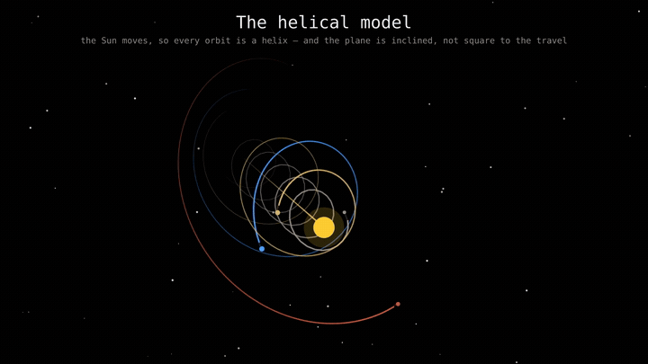

# Codimate

[](https://pypi.org/project/codimate/)
[](https://pypi.org/project/codimate/)

**Make an explainer video from Python data and logic.**

Write the calculation or algorithm. Choose the moments worth showing. Draw
what those moments look like. Codimate animates the changes between them.

Use it for sorting demonstrations, growing charts, mathematical explanations,
and scientific models. You supply the model; Codimate supplies the animation.



[Source for this animation](https://github.com/darhnoel/codimate-examples/tree/main/helical_solar_system)

## Start here

| What you want | Where to go |
| --- | --- |
| Make your first video | [First animation](docs/tutorial.md) |
| Understand how data becomes movement | [How it works](docs/concepts.md) |
| Draw and place shapes | [Drawing and layout](docs/drawing.md) |
| Add highlighting, motion, formulas, or audio | [Recipes](docs/recipes.md) |
| Look up an argument or method | [Reference](docs/reference.md) |
| Fix an error or unexpected picture | [Troubleshooting](docs/troubleshooting.md) |

You only need basic Python: functions, loops, and dictionaries.
Start with the tutorial; you do not need to read the whole reference first.

## Install

Use Python 3.9 or newer. In a terminal:

```bash
python -m pip install codimate
```

You can work in any folder. You do **not** need to clone this repository or
install Rust to make animations.

Codimate needs FFmpeg to encode video. It uses an installed FFmpeg if one is
available, otherwise the copy supplied by its Python dependency.
[Installation help](docs/troubleshooting.md#installation-and-tools).

Typst is optional: install it only when you want LaTeX formulas.
[Formula setup](docs/recipes.md#add-a-formula).

## Try a complete program

Save this as `counter.py` in your working folder:

```python
import codimate as cm


def count(state, emit):
    for value in range(1, 6):
        state["count"] = value
        emit("counted")


def view(frame):
    scene = cm.Scene()
    value = frame.state["count"]
    scene.rect("bar", w=160, h=max(value * 70, 1),
               at=cm.at(x=640, bottom=550)).fill("blue")
    scene.text("label", f"Count: {value}", size=36,
               at=(640, 610)).fill("white")
    return scene


explanation = cm.explain(
    trace=cm.trace(count, {"count": 0}),
    view=view,
    timing=cm.Timing(default=0.5, opening=0.3, final_hold=1.0),
)
explanation.render("results/counter.mp4")
```

Run it with the same Python you used to install Codimate:

```bash
python counter.py
```

Open `results/counter.mp4`. A blue bar grows through five values while its
label counts from 0 to 5. Codimate creates the output folder for you.

## What just happened?

1. `count()` changed the data and called `emit()` after each change.
2. `cm.trace()` saved the starting data and each emitted moment.
3. `view()` drew a bar and a label for each saved moment.
4. Codimate matched shapes with the same name and animated their differences.
5. `Timing` set the pace, and `render()` wrote the video.

The name `"bar"` stays the same, so Codimate knows it is the same bar growing.
Changing that name at every event would make separate bars fade in and out.

Continue with [First animation](docs/tutorial.md) for a step-by-step walkthrough.

## Examples and documentation

[Read the documentation site](https://darhnoel.github.io/codimate/).
The [examples repository](https://github.com/darhnoel/codimate-examples)
contains complete programs for physics, mathematics, and algorithms.
Each example has its own explanation and run instructions.

## Contributing to the engine

These commands are for developing Codimate itself. Animation authors can use
`pip install codimate` instead.

```bash
git clone https://github.com/darhnoel/codimate
cd codimate
python3 -m venv .venv
.venv/bin/python -m pip install maturin
.venv/bin/maturin develop --release
.venv/bin/python python/tests/run.py
```

Use a release build for normal rendering. Debug builds render much more slowly.
See [the architecture decisions](docs/adr/) for engine design.

To build the documentation site locally:

```bash
python -m pip install markdown pygments pdoc
python docs/build_site.py
python docs/check_links.py
```

Open `site/index.html` after the build.

## License

[MIT](LICENSE). Bundled fonts retain their own licenses, listed in
[the font license directory](crates/codimate-fonts/fonts/LICENSES/README.md).
