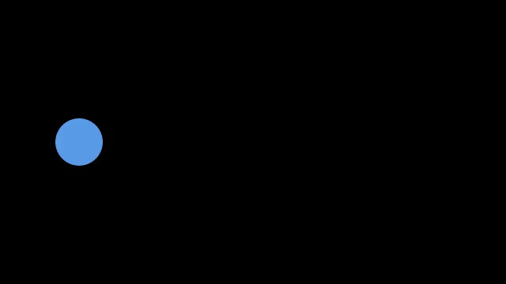

# Concepts

One ball, two moments: left, then right. Codimate makes the movement between them.
Here are the main ideas, using that same ball each time.



## State: the data now

State is the information your program works with. Our ball only needs an x position:

```python
@dataclass
class Ball:
    x: float = 100
```

Write the state as a dataclass. You read it as `ball.x`, a misspelled field is an
error instead of a silent new key, and every field and its starting value is in one
place. A plain dict works too, for a quick sketch.

## Algorithm: what changes

An algorithm is your Python logic. Ours changes the ball's position:

```python
ball.x = 540
```

Codimate does not decide where a ball should go or calculate your physics.
Your code does that.

## Event: a moment worth saving

Call `emit()` after a change you want to show:

```python
ball.x = 540
emit("moved")
```

`emit` is given to your algorithm as an argument. An event name such as `"moved"`
says what happened; it does not identify a shape.

## Trace: the saved moments

A trace holds the starting data and a copy saved at each event:

```python
trace = cm.trace(move, Ball())
```

For our ball, the trace saves **x=100 → x=540**. `move` is the function from the
[tutorial](tutorial.md). It runs once, rather than once for each video frame.

## Frame: a saved moment handed to your view

Read its state to find where the ball belongs:

```python
x = frame.state.x
```

A `Frame` here is a saved moment from the trace, not every image in the exported
video. The opening moment has no event: `frame.event` is `None`.

## View: how to draw a moment

The view is a function that turns saved data into a picture:

```python
def view(frame):
    scene = cm.Scene()
    scene.circle("ball", r=30, at=(frame.state.x, 180)).fill("blue")
    return scene
```

The same saved data should always give the same picture. Update the model in your
algorithm; read it in the view.

## Scene: the picture

A scene contains the shapes for one moment:

```python
scene = cm.Scene()
scene.circle("ball", r=30, at=(100, 180)).fill("blue")
```

You can put circles, rectangles, text, formulas, images, and more in a scene.

## Names: how Codimate recognizes things

Use `"ball"` in both pictures to say it is the same ball:

```python
scene.circle("ball", r=30, at=(x, 180))
```

Same name + different position = movement.
A different name means a different thing, so it fades in or out instead.
Each complete shape name must be unique in a scene.

## Items: separate things with their own names

Two balls can have the same value and still be different balls:

```python
balls = cm.items([30, 30])
```

Each item has a `.value` and a different `.id`. Use the ID as its shape name
when the item should travel. Fixed chart bars can use category names instead.

## Groups: parts that belong together

A group lets a ball and its label travel together:

```python
ball = scene.group("ball", at=(x, 180))
ball.circle("body", r=30).fill("blue")
ball.text("label", "A", size=24)
```

Inside the group, `(0, 0)` means the group's point. Its shapes have complete
names such as `ball/body` and `ball/label`.

## Slots: places to put things

A slot gives an object a place on the screen. It does not draw a shape:

```python
for slot, name in cm.row(("A", "B"), gap=80, size=100):
    scene.group(name, slot).circle("body", r=30).fill("blue")
```

Think of two empty seats: the slots are the seats; the balls are what sits there.

## Motion: which path to take

Motion chooses how a shape travels between its saved positions:

```python
motion = [cm.Rule("*", position="linear")]
```

`linear` keeps the movement steady. The default `straight` slows down at the
start and end. A rule only changes the path; the saved positions decide where to go.

## Timing: how long it takes

Timing sets seconds in the video:

```python
timing = cm.Timing(default=2.0)
```

Our ball's move takes two seconds. Python still runs the algorithm normally;
it does not wait two seconds while recording the trace.

## Explanation: put it all together

An explanation connects the trace, view, motion, and timing:

```python
explanation = cm.explain(trace=trace, view=view, timing=timing)
```

The examples above are small pieces of the [complete tutorial program](tutorial.md),
not separate scripts.

## Render: make the video

Rendering draws the in-between pictures and writes the file:

```python
explanation.render("ball.mp4")
```

You choose what changes. Codimate handles the pictures between your moments.

[Try the tutorial →](tutorial.md)
