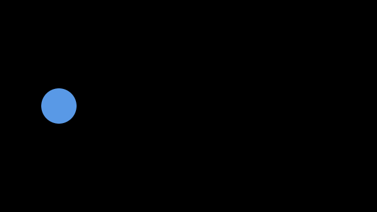
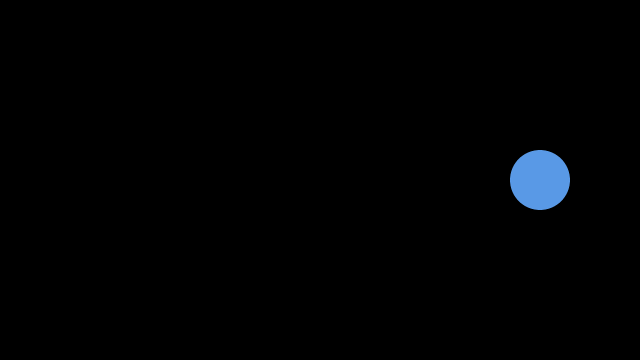
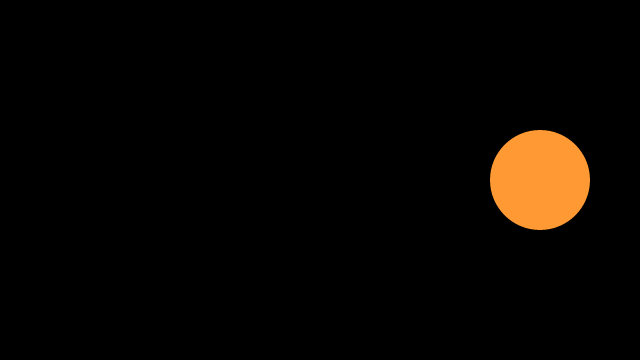
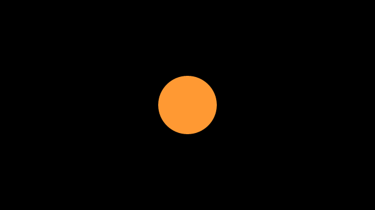

# Tutorial

Let's make a ball move. Then change its color, size, and speed.
You only need basic Python. We will use the same small program throughout.

## 1. Copy and run

Install Codimate if you have not already:

```bash
python -m pip install codimate
```

Save this program as `ball.py` in any folder:

```python
import codimate as cm

cm.canvas(640, 360)


def move(state, emit):
    state["x"] = 540
    emit("moved")


def view(frame):
    scene = cm.Scene()
    scene.circle("ball", r=30, at=(frame.state["x"], 180)).fill("blue")
    return scene


explanation = cm.explain(
    trace=cm.trace(move, {"x": 100}),
    view=view,
    timing=cm.Timing(default=2.0, opening=0.5, final_hold=0.5),
)
explanation.render("ball.mp4")
```

In that folder, run:

```bash
python ball.py
```

Open `ball.mp4`. **You should see a blue ball move from left to right.**


The file is saved in the folder where you ran the command. If the command fails,
see [Setup help](reference.md#setup-help).

## 2. See the two moments

Codimate gets two pictures from your program:

**Before:** the ball's x position is 100.



**After:** the ball's x position is 540.



Both pictures call it `"ball"`. That tells Codimate it is the same ball.
Codimate fills in the movement between those pictures.

## 3. Read the program in small pieces

### Set the screen size

```python
cm.canvas(640, 360)
```

The screen is 640 units wide and 360 units tall. The top-left corner is `(0, 0)`.
Moving right makes x bigger. Moving down makes y bigger.

### Say what changes

```python
def move(state, emit):
    state["x"] = 540
    emit("moved")
```

`state` holds the ball's position. Change it, then call `emit()` to save that moment.
`"moved"` is the event's name. It tells us what happened.

### Draw a moment

```python
def view(frame):
    scene = cm.Scene()
    scene.circle("ball", r=30, at=(frame.state["x"], 180)).fill("blue")
    return scene
```

`frame.state` is the data saved for this moment. `Scene()` starts an empty picture.
The circle's name is `"ball"`, its radius is 30, and its height on screen is y=180.

This function draws one moment. It does not move the ball itself.

### Connect the pieces

```python
explanation = cm.explain(
    trace=cm.trace(move, {"x": 100}),
    view=view,
    timing=cm.Timing(default=2.0, opening=0.5, final_hold=0.5),
)
```

The ball starts at x=100. `trace` runs `move()` and saves what happens.
`view` draws the saved moments. `Timing` gives the move two seconds.

`opening` holds the first picture for half a second. `final_hold` holds the last
picture for another half second.

### Save the video

```python
explanation.render("ball.mp4")
```

`render` draws the video frames and saves the file. By default, it also saves a
small `.index.bin` file used by the previewer. You can leave that file alone.

## 4. Change the color

Change just the final part of the circle line:

```python
scene.circle("ball", r=30, at=(frame.state["x"], 180)).fill("orange")
```

Run `python ball.py` again. **The movement stays the same; the ball is now orange.**


## 5. Make the ball bigger

Keep the orange color and change `r=30` to `r=50`:

```python
scene.circle("ball", r=50, at=(frame.state["x"], 180)).fill("orange")
```

Run it again. **The ball is bigger, but still moves to the same place.**



## 6. Make the movement slower

Change `default=2.0` to `default=4.0` in your `Timing` line.

```python
timing=cm.Timing(default=4.0, opening=0.5, final_hold=0.5)
```

Run it again. **The ball takes four seconds to cross the screen instead of two.**
Its final picture is unchanged; only the time changes.

## 7. Add a middle stop

Replace just the `move()` function:

```python
def move(state, emit):
    state["x"] = 320
    emit("moved")
    state["x"] = 540
    emit("moved")
```

You now save three moments: **left → middle → right**.



Codimate moves between each pair of moments. With `default=4.0`, each move takes
four seconds, so the two moves take eight seconds in total, plus the holds.
The default motion slows down at each saved position.

## What to remember

**Change data → save a moment → draw it → let Codimate animate the change.**

Keep a shape's name the same when it is the same thing. Change its position,
size, or color to change what the viewer sees.

[Concepts](concepts.md) briefly explains all the terms.
[Reference](reference.md) helps you draw more, add sound, or choose a movement path.
[API](api/codimate.html) lists the public classes, functions, methods, and their arguments.
